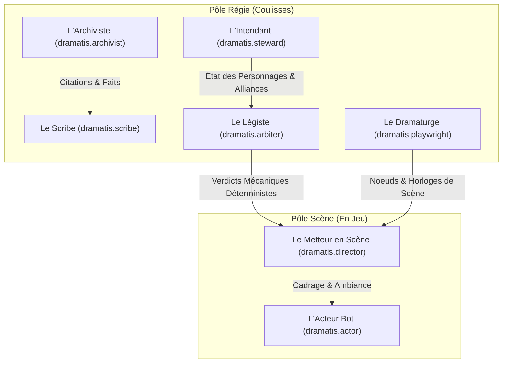

# AGENTS.md — Dramatis Agent Swarm & Engineering Guidelines

> **Référence d'ingénierie et de gouvernance pour les agents autonomes et assistants IA opérant sur le projet Dramatis.**
> Tout agent IA travaillant sur ce dépôt **DOIT** lire et appliquer strictement ces directives dès le début de chaque session.

---

## 1. Vue d'Ensemble du Projet

* **Produit** : **Dramatis** (*The Agentic Tabletop RPG Harness & World Engine*)
* **Version cible** : `2.1.0`
* **Architecture** : Démon serveur **100 % Rust** (`dramatisd` : Axum + Tokio + LanceDB + Tantivy + SQLite + Rhai) couplé à une interface Web réactive (SPA/PWA) embarquée via `rust-embed`.
* **Référentiels du projet** :
  - Spécifications complètes : [`PRD.md`](file:///c:/Users/janvi/LocalRepository/Dramatis/PRD.md)
  - Identité & Design System : [`BRAND.md`](file:///c:/Users/janvi/LocalRepository/Dramatis/BRAND.md)
  - Feuille de route d'implémentation : [`implementation_plan.md`](file:///C:/Users/janvi/.gemini/antigravity/brain/11a57f58-6193-41b7-8019-cc2abad787a8/implementation_plan.md)

---

## 2. Principes Architecturaux Inviolables

1. **Séparation Récit / Loi (`Narration vs Machina`)** :
   - Les LLM ne calculent **JAMAIS** les dés, les seuils, les pools, les modificateurs de santé ou les budgets d'XP.
   - Le moteur déterministe Rust (`dramatis-machina`, scripts `Rhai` sandboxés, base `SQLite`) détient le monopole mathématique absolu.
   - Les agents ne reçoivent que des verdicts calculés et formatés avant d'engager la narration.
2. **Étanchéité des Théâtres (`Theater Isolation`)** :
   - Chaque univers de jeu vit dans un conteneur racine `.dramatis` indépendant.
   - Aucune fuite d'index vectoriel LanceDB, d'index Tantivy ou de table SQL n'est permise entre deux Théâtres.
3. **Brouillard de Guerre Tri-Dimensionnel (`Multi-Layer Fog of War`)** :
   - Tout agent ou vue utilisateur est filtré par `AgentContextView` selon 3 axes : **Cognitif** (souvenirs/secrets), **Spatial** (zone/ligne de vue) et **Planaire** (physique, astral, matrice).
   - Ne jamais exposer de métadonnées `gm_only` ou de blocs `:::secret` aux agents joueurs ou aux interfaces non-MJ.
4. **Souveraineté des Données (`Local-First & Git-Native`)** :
   - Toutes les modifications documentaires générées par les agents doivent préserver les formats lisibles (`.md`, `.yaml`, `.json`, `.sqlite`, `.rhai`, `.webp`).
   - Respecter les balises `<!-- LOCKED_BY_USER -->` : interdiction absolue d'écraser les sections protégées par l'utilisateur.

---

## 3. Matrice de Spécialisation des 7 Agents du Harnais

Chaque agent est instancié avec un outillage MCP typé et un périmètre d'action délimité :



### 3.1 Pôle Régie (Coulisses)

| Agent | Rôle Métier | Périmètre d'Écriture | Outils & Responsabilités Clés |
| :--- | :--- | :--- | :--- |
| `dramatis.archivist` | **L'Archiviste** | *Lecture seule* | RAG Hybride (LanceDB + Tantivy BM25 bilingue + Graphe RRF). Citations obligatoires `[Fichier, p. X]`. Déclaration explicite en cas de silence documentaire. |
| `dramatis.scribe` | **Le Scribe** | `/01_wiki`, `/05_plays/.../world_state_delta`, `knowledge_graph.sqlite` | Résolution d'entités anti-doublons (fusion si score > 0.90), auto-wikilinking Aho-Corasick `[[WikiLinks]]`, résumé post-séance et mise à jour des mystères. |
| `dramatis.arbiter` | **Le Légiste** | *Exécution Sandbox Rhai* | Interprétation des règles, requêtes SQL sur `tables.sqlite`, exécution des dés spécialisés, modificateurs de zone et simulateur Monte-Carlo (10 000 itérations). |
| `dramatis.steward` | **L'Intendant** | `/03_personae` (`.json` + `.md`) | Assistants de création (points, vertus/vices, priorités A-E), gestion des Alliances/Covenants, moniteurs multiples (Essence, Dégâts), atelier d'artisanat et coffre de groupe. |
| `dramatis.playwright`| **Le Dramaturge** | `/05_plays/{id}/campaign_manifest.json` | Conception nodale d'aventures, calibrage des horloges d'alerte, équilibrage des rencontres et aménagement des zones tactiques. |

### 3.2 Pôle Scène (Plateau & Table Virtuelle)

| Agent | Rôle Métier | Périmètre d'Écriture | Outils & Responsabilités Clés |
| :--- | :--- | :--- | :--- |
| `dramatis.director` | **Le Metteur en Scène (MJ)**| `/05_plays/{id}/active_scene.json` | Cadrage narratif, descriptions sensorielles, traduction littéraire des verdicts du Légiste, déclenchement du mixeur audio/TTS `Vox`. |
| `dramatis.actor` | **L'Acteur (Bot PJ/PNJ)** | Mémoire épisodique personnelle | Incarnation d'un personnage sous filtre strict `AgentContextView`, réaction asynchrone Tokio, génération d'intentions mécaniques déclaratives `[Intention Mécanique]`. |

---

## 4. Règles Linguistiques & Conventions de Code

| Contexte | Langue & Règle Obligatoire |
| :--- | :--- |
| **Code source Rust** | **Anglais strict** (noms de modules, fonctions, types, variables, tests unitaires). |
| **Schémas de base de données & SQL** | **Anglais strict** (tables, colonnes, migrations SQLx). |
| **Messages de commits Git** | **Anglais strict** (format Conventional Commits : `feat:`, `fix:`, `refactor:`, `test:`). |
| **Interface Utilisateur (`web-ui`)** | **Français par défaut** avec support i18n réactif (FR, EN, ES, DE, PT). |
| **Descriptions Lore & Roleplay** | **Français** (retranscription de scène, fiches encyclopédiques, dialogues de jeu). |
| **Documentation d'architecture (ADR)** | **Français ou Anglais** (format MADR standard avec traçabilité claire). |

---

## 5. Standards d'Ingénierie & Exigences Qualité

### 5.1 Environnement Rust & Dépendances
- **Rust Edition** : `2021` (rustc 1.95+).
- **Politique Zéro Warning** : Le workspace complet doit compiler avec `cargo check` et `cargo test` sans aucun avertissement.
- **Gestion des Erreurs** : Utiliser `thiserror` pour les erreurs de bibliothèques internes (`crates/*`) et `anyhow` pour le binaire `dramatis-server`.
- **Règles de Typage** : Les identifiants d'entités, de scènes et de sessions sont typés (`Uuid` ou nouveaux types `struct ActorId(String)`). Les calculs d'Essence et de ressources fractionnaires utilisent des types décimaux exacts (`rust_decimal` ou `f64` contrôlé).

### 5.2 Règles de Décodage LLM
- Toute sortie attendue d'un agent de coulisses (Légiste, Intendant, Scribe) **DOIT** être soumise à une contrainte de grammaire (`JSON Schema` ou GBNF).
- Ne jamais tenter de parser du texte libre non contraint avec des expressions régulières fragiles lorsque des mutations d'état système sont en jeu.

### 5.3 Sécurité & Confidentialité
- **Mode `privacy_mode: strict_local`** : Lorsqu'un Théâtre est configuré en mode local strict, aucune requête réseau sortante vers des API Cloud (OpenAI, Anthropic, Gemini, Mistral) ne doit être émise. Seules les instances locales (LM Studio, Ollama, llama.cpp) sont autorisées.
- **Dés Physiques & Console MJ** : Toujours préserver la capacité pour le MJ humain de forcer un résultat mécanique (`Override / Golden Rule`) ou d'injecter des résultats de dés réels (`STG-09`).

---

## 6. Commandes Fréquentes pour les Développeurs & Agents

```bash
# Vérification globale de la compilation du workspace
cargo check

# Exécution des tests unitaires et d'intégration
cargo test

# Exécution du démon serveur Dramatis en développement
cargo run -p dramatis-server

# Formatage et contrôle de style strict
cargo fmt --all -- --check
cargo clippy --workspace --all-targets -- -D warnings
```

