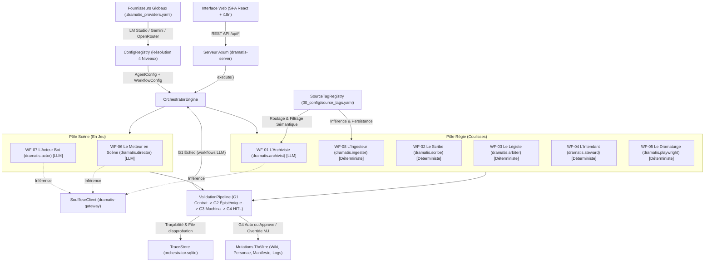
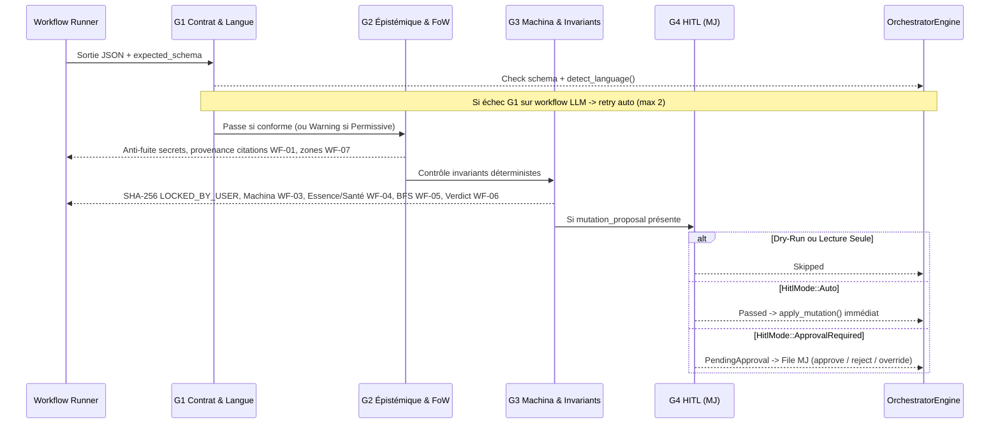

# AGENT_WORKFLOWS — Architecture des Agents & Workflows Agentiques de Dramatis

> **Référence technique et opérationnelle du harnais d'orchestration [`dramatis-orchestrator`](file:///c:/Users/janvi/LocalRepository/Dramatis/crates/dramatis-orchestrator/Cargo.toml), du moteur de tags sémantiques [`source_tags.rs`](file:///c:/Users/janvi/LocalRepository/Dramatis/crates/dramatis-core/src/source_tags.rs) et du pipeline de gouvernance 4 portes (`G1`–`G4`).**

---

## 1. Architecture Générale du Harnais Agentique

Dramatis repose sur une séparation stricte entre **Narration / Raisonnement LLM** et **Loi Déterministe Rust (`Narration vs Machina`)**. Sur les **8 agents** du harnais, seuls **3** sollicitent le client LLM (`SouffleurClient`) tandis que **5** exécutent exclusivement du code Rust déterministe (parsers, SQLite, sandbox Rhai, moteur de création, Graphe/Tantivy, SHA-256).

### Principes d'Exécution (`OrchestratorEngine::execute`)

1. **Résolution de configuration** : Charge `AgentConfig` et `WorkflowConfig` via `ConfigRegistry`. Si `enabled == false` sur l'agent ou le workflow, l'exécution est refusée.
2. **Garde-fou `strict_local`** : Avant tout appel LLM (`WF-01`, `WF-06`, `WF-07`), si le Théâtre ou l'agent est configuré en `strict_local` et que `model.is_local()` est faux (`provider` hors `local_lmstudio`/`ollama`/`llamacpp`/`local` et URL hors `127.0.0.1`/`localhost`), `OrchestratorEngine` rejette l'appel avec `OrchestratorError::PrivacyViolation`.
3. **Boucle de retry sur `G1`** : Pour les workflows utilisant un LLM, si la porte `G1 Contrat` échoue (schéma JSON ou politique linguistique), le moteur réessaie jusqu'à `1 + workflow_cfg.max_retries.min(2)` tentatives en injectant un `language_retry_hint` ciblé.
4. **Validation & File HITL** : À l'issue de `ValidationPipeline::run`, la trace complète est enregistrée dans `TraceStore` (`orchestrator.sqlite`), et toute mutation proposée est soit appliquée immédiatement (`HitlMode::Auto`), soit placée en attente d'arbitrage humain MJ (`HitlMode::ApprovalRequired`).

---

## 2. Matrice de Spécialisation des 8 Agents

| Agent ID | Workflow | Nom Affiché | Pôle | Moteur | Périmètre d'Écriture | Temp. / Max Tokens | HITL Défaut | Schéma JSON de Sortie |
| :--- | :--- | :--- | :--- | :--- | :--- | :--- | :--- | :--- |
| `dramatis.archivist` | `WF-01` | L'Archiviste | Régie | Hybride + LLM | Lecture seule (aucune écriture) | `0.15` / `1024` | `Auto` | `schemas/archivist_verdict.v1.json` |
| `dramatis.scribe` | `WF-02` | Le Scribe | Régie | Déterministe | `/01_wiki/**/*.md`, `/04_index/knowledge_graph.sqlite` | `0.20` / `1536` | `ApprovalRequired` | `schemas/scribe_proposal.v1.json` |
| `dramatis.arbiter` | `WF-03` | Le Légiste | Régie | Déterministe (`dramatis-machina`) | Sandbox Rhai (aucune narration directe) | `0.00` / `768` | `Auto` | `schemas/arbiter_verdict.v1.json` |
| `dramatis.steward` | `WF-04` | L'Intendant | Régie | Déterministe (`dramatis-core`) | `/03_personae/*.json`, `/03_personae/*.md` | `0.10` / `1024` | `ApprovalRequired` | `schemas/steward_audit.v1.json` |
| `dramatis.playwright` | `WF-05` | Le Dramaturge | Régie | Déterministe (`dramatis-stage`) | `/05_plays/*/campaign_manifest.json` | `0.40` / `1536` | `ApprovalRequired` | `schemas/playwright_manifest.v1.json` |
| `dramatis.director` | `WF-06` | Le Metteur en Scène | Scène | LLM + Audio/Logs | `/05_plays/*/session_logs.jsonl` | `0.65` / `1024` | `Auto` | `schemas/director_scene.v1.json` |
| `dramatis.actor` | `WF-07` | L'Acteur Bot | Scène | LLM sous Brouillard | Mémoire épisodique personnelle & canal de Zone | `0.70` / `512` | `Auto` | `schemas/actor_turn.v1.json` |
| `dramatis.ingester` | `WF-08` | L'Ingesteur | Régie | Déterministe (Multi-Format) | `/00_sources` & `/04_index` (`strict_local`) | `0.00` / `512` | `Auto` | `schemas/ingest_report.v1.json` |

### Permissions d'Outillage (Autorisés / Interdits)

| Agent | Outils Autorisés (`tools.allowed`) | Outils Interdits (`tools.denied`) |
| :--- | :--- | :--- |
| `dramatis.archivist` | `rag.hybrid_search`, `rag.section_scanner`, `graph.query_entities`, `+ Source Tag Semantic Router` | `fs.write`, `machina.mutate_state` |
| `dramatis.scribe` | `rag.entity_resolver`, `rag.autowikilink`, `wiki.non_destructive_patch` | `machina.roll` |
| `dramatis.arbiter` | `machina.dice_engine`, `machina.rhai_sandbox`, `machina.sqlite_tables`, `machina.monte_carlo` | `llm.invent_dice_result`, `wiki.write` |
| `dramatis.steward` | `core.creation_engine`, `core.artificer_engine`, `core.persona_store` | `stage.broadcast_public` |
| `dramatis.playwright` | `stage.campaign_manifest`, `machina.monte_carlo` | `persona.mutate` |
| `dramatis.director` | `stage.session_logger`, `stage.vox_audio`, `stage.channel_router` | `machina.override_dice` |
| `dramatis.actor` | `stage.agent_context_view`, `stage.declare_intent` | `core.gm_secrets`, `machina.roll` |
| `dramatis.ingester` | `ingest.pdf`, `ingest.markdown`, `ingest.excel`, `ingest.media`, `ingest.sha256` | `core.gm_secrets` |

---

## 3. Catalogue Détaillé des 8 Workflows (`WF-01` à `WF-08`)

### `WF-01` — Recherche Canonique (`dramatis.archivist`)

* **Fichier** : [`wf01_archivist.rs`](file:///c:/Users/janvi/LocalRepository/Dramatis/crates/dramatis-orchestrator/src/workflows/wf01_archivist.rs)
* **Politique linguistique** : `MatchUserQuery` (répond strictement dans la langue de la requête) — `max_retries = 2`
* **Étapes du graphe** :
  1. `query_analysis` — Analyse de requête & expansion bilingue
  2. `hybrid_retrieval` — Récupération hybride (Tantivy + Graphe + Scanner) + **Routage par Tags Sémantiques**
  3. `relevance_gate` — Seuil de pertinence & silence documentaire
  4. `grounded_synthesis` — Synthèse LLM contrainte par sources (avec repli hors-ligne si aucun LLM joignable)
  5. `citation_verifier` — Vérification de provenance des citations
* **Entrée & Paramètres configurables** :
  * Champ dédié de filtrage sémantique : `required_tags: Option<Vec<String>>`
  * `workflow_params` : `top_k_chunks` (`4`), `silence_threshold` (`1`), `rrf_weight_bm25` (`0.5`), `rrf_weight_vector` (`0.3`), `rrf_weight_graph` (`0.2`)
* **Garde-fous** : En mode `Role::Player`, exclusion matérielle préalable de tout fichier marqué `gm_only` ou tagué `gm_secret`. Déclaration explicite de silence documentaire si les extraits sont sous le seuil.

### `WF-02` — Chronique & Résolution Wiki (`dramatis.scribe`)

* **Fichier** : [`wf02_scribe.rs`](file:///c:/Users/janvi/LocalRepository/Dramatis/crates/dramatis-orchestrator/src/workflows/wf02_scribe.rs)
* **Politique linguistique** : `ForceFr` — `HitlMode::ApprovalRequired` (`scribe_write_wiki`)
* **Étapes du graphe** :
  1. `extract_candidates` — Extraction des entités & relations
  2. `entity_resolution` — Résolution anti-doublon (`knowledge_graph`)
  3. `lock_check` — Contrôle des verrous `<!-- LOCKED_BY_USER -->`
  4. `auto_wikilink` — Injection Aho-Corasick `[[WikiLinks]]`
  5. `diff_proposal` — Préparation du patch & diff unifié
* **Entrée (`ScribeInput`)** : `entity_title`, `category` (défaut `"concepts"`), `section_title` (défaut `"Notes du Scribe"`), `aliases`, `markdown_delta`.
* **Paramètres configurables** : `dedup_threshold` (`0.90`), `auto_wikilink` (`true`), `chronicle_tone` (`"encyclopedique"`), `respect_locked_sections` (`true`).

### `WF-03` — Arbitrage Mécanique (`dramatis.arbiter`)

* **Fichier** : [`wf03_arbiter.rs`](file:///c:/Users/janvi/LocalRepository/Dramatis/crates/dramatis-orchestrator/src/workflows/wf03_arbiter.rs)
* **Politique linguistique** : `ForceFr` — `HitlMode::Auto` — Aucun LLM dans le calcul mathématique (`machina_deterministic_source = true`)
* **Étapes du graphe** :
  1. `intent_parsing` — Normalisation de l'intention mécanique
  2. `rule_lookup` — Consultation des tables mécaniques SQLite
  3. `machina_execution` — Exécution déterministe (Dés / Rhai)
  4. `monte_carlo_check` — Simulation statistique Monte-Carlo
  5. `verdict_formatting` — Formatage du `MechanicalResolution`
* **Entrée (`ArbiterInput`)** : `actor_id`, `action_type`, `target_id`, `skill_expression`, `roll_mode` (`"expression"` | `"standard"` | `"shadowrun"` | `"ars_magica"` | `"rhai"`), `target_defense`, `situational_modifiers`, `rhai_script`, `rhai_vars`, `physical_roll_override`, `run_monte_carlo`, `monte_carlo_iterations`.
* **Paramètres configurables** : `physical_dice_mode` (`"off"`), `run_monte_carlo` (`false`), `monte_carlo_iterations` (`10000`), `strict_raw` (`true`), `default_roll_mode` (`"expression"` — surchargé en `"ars_magica"` ou `"shadowrun"` selon le preset du Théâtre).

### `WF-04` — Intendance Personnages & Alliances (`dramatis.steward`)

* **Fichier** : [`wf04_steward.rs`](file:///c:/Users/janvi/LocalRepository/Dramatis/crates/dramatis-orchestrator/src/workflows/wf04_steward.rs)
* **Politique linguistique** : `ForceFr` — `HitlMode::ApprovalRequired` (`steward_write_persona`)
* **Étapes du graphe** :
  1. `load_sheet` — Chargement / initialisation de fiche
  2. `proposal_generation` — Calcul de la mutation proposée
  3. `deterministic_audit` — Audit mathématique & règles de création
  4. `sheet_sync` — Préparation synchro JSON & Markdown
* **Entrée (`StewardInput`)** : `persona_id`, `mutation_type` (`"create_persona"` | `"apply_damage"` | `"spend_xp"` | `"update_essence"` | `"validate_ars_magica"` | `"validate_shadowrun"` | `"craft_artificer"`), `name`, `archetype`, `monitor_name`, `amount`, `is_magus`, `creation_input`, `craft_input`.
* **Paramètres configurables** : `creation_rules_profile` (`"auto"`, surchargé en `"ars_magica_5e"` ou `"priorities_A_E"` selon le preset), `allow_house_rules` (`false`), `auto_recalculate_derived_stats` (`true`).

### `WF-05` — Conception Nodale & Horloges (`dramatis.playwright`)

* **Fichier** : [`wf05_playwright.rs`](file:///c:/Users/janvi/LocalRepository/Dramatis/crates/dramatis-orchestrator/src/workflows/wf05_playwright.rs)
* **Politique linguistique** : `ForceFr` — `HitlMode::ApprovalRequired` (`playwright_write_manifest`)
* **Étapes du graphe** :
  1. `world_state_read` — Lecture du manifeste de campagne
  2. `node_graph_draft` — Édition des nœuds & horloges de scène
  3. `encounter_balancing` — Calibrage de létalité (Monte-Carlo)
  4. `manifest_validation` — Vérification de connexité du graphe
* **Entrée (`PlaywrightInput`)** : `play_id`, `campaign_name`, `new_scene`, `link_from_scene`, `new_clock`, `advance_clock` (`clock_id`, `delta_segments`), `encounter_test` (`dice_count`, `dice_sides`, `modifier`, `threshold`).
* **Paramètres configurables** : `pacing_profile` (`"investigation"`), `lethality_target` (`15`), `clue_redundancy` (`3`).

### `WF-06` — Mise en Scène & Narration Live (`dramatis.director`)

* **Fichier** : [`wf06_director.rs`](file:///c:/Users/janvi/LocalRepository/Dramatis/crates/dramatis-orchestrator/src/workflows/wf06_director.rs)
* **Politique linguistique** : `ForceFr` — `HitlMode::Auto` (`director_append_log` dans `/05_plays/*/session_logs.jsonl`)
* **Étapes du graphe** :
  1. `context_assembly` — Assemblage scène & verdict du Légiste
  2. `sensory_drafting` — Rédaction narrative sensorielle
  3. `audio_cue_extraction` — Émission d'ambiance audio Vox
  4. `leak_check` — Contrôle anti-fuite secrets MJ
* **Entrée (`DirectorInput`)** : `play_id`, `zone_id`, `scene_summary`, `mechanical_resolution` (verdict issu de `WF-03`), `gm_secrets`, `ambient_mood`.
* **Paramètres configurables** : `narrative_style` (`"sensoriel_sombre"`), `max_response_paragraphs` (`3`), `tts_enabled` (`false`).

### `WF-07` — Incarnation Acteur Sous Brouillard (`dramatis.actor`)

* **Fichier** : [`wf07_actor.rs`](file:///c:/Users/janvi/LocalRepository/Dramatis/crates/dramatis-orchestrator/src/workflows/wf07_actor.rs)
* **Politique linguistique** : `ForceFr` — `HitlMode::Auto` — Lecture seule sur l'univers
* **Étapes du graphe** :
  1. `fog_filter` — Filtrage tri-dimensionnel `AgentContextView`
  2. `episodic_recall` — Lecture mémoire & fiche personnage
  3. `in_character_reaction` — Génération réplique & intention
  4. `handoff_to_arbiter` — Routage vers `WF-03` si intention mécanique
* **Entrée (`ActorInput`)** : `actor_id`, `actor_name`, `current_zone`, `active_plane` (`RealityPlane`), `visible_zones`, `known_secrets`, `scene_events` (`zone_id`, `plane`, `is_gm_only`, `content`), `prompt`, `requested_action_expression`.
* **Paramètres configurables** : `autonomy_level` (`"reactive"`), `verbosity` (`"concis"`), `emit_mechanical_intent` (`true`).

### `WF-08` — Ingestion & Indexation Multi-Format (`dramatis.ingester`)

* **Fichier** : [`wf08_ingester.rs`](file:///c:/Users/janvi/LocalRepository/Dramatis/crates/dramatis-orchestrator/src/workflows/wf08_ingester.rs)
* **Politique linguistique** : `ForceFr` — `HitlMode::Auto` — `PrivacyOverride::StrictLocal` forcé par défaut
* **Étapes du graphe** :
  1. `format_detection` — Détection du format (`markdown`, `pdf`, `excel`, `image`, `audio`) & routage
  2. `sha256_dedup` — Contrôle d'empreinte SHA-256
  3. `typed_extraction` — Extraction, découpage spécialisé & résolution des tags sémantiques
  4. `index_registration` — Enregistrement dans l'index du Théâtre & persistance des tags dans `00_config/source_tags.yaml` (si `!dry_run`)
* **Entrée** : Document source multi-format + `tags` optionnel (inféré automatiquement via `SourceTagRegistry::infer_tags_for_source` si omis).
* **Paramètres configurables** : `max_chunk_chars` (`1200`), `enable_sha256_dedup` (`true`), `auto_transpile_excel_rhai` (`true`).

---

## 4. Pipeline de Validation 4 Portes (`G1`–`G4`)

Chaque exécution est auditée séquentiellement par `ValidationPipeline::run` dans [`validation.rs`](file:///c:/Users/janvi/LocalRepository/Dramatis/crates/dramatis-orchestrator/src/validation.rs) :

### Détail des Contrôles par Porte

* **`G1` — Contrat JSON & Politique Linguistique (`validate_g1_contract`)**
  * Vérifie le schéma JSON attendu (`required`, `properties`, `enum`).
  * Détecte la langue du texte principal (`answer`, `narration`, `dialogue`, `summary`) et vérifie `ForceFr`, `ForceEn` ou `MatchUserQuery`. En profil `ValidationProfile::Permissive`, un échec devient `Warning`.
* **`G2` — Intégrité Épistémique & Brouillard de Guerre (`validate_g2_epistemic`)**
  * **Anti-fuite** : Si `role != Role::Gm` ou sur les workflows publics (`WF-06`, `WF-07`), bloque toute sortie contenant `:::secret`, `gm_only` ou un secret listé dans `forbidden_secrets`.
  * **Provenance `WF-01`** : Contrôle que chaque citation (`source_file`) provient bien des extraits effectivement récupérés (`retrieved_sources`).
  * **Brouillard spatial `WF-07`** : Vérifie qu'un acteur non-MJ n'a pas accédé à une zone absente de `current_zone` et `visible_zones`.
* **`G3` — Invariants Machina & Structurels (`validate_g3_machina`)**
  * **`WF-02` Scribe** : Compare les empreintes SHA-256 de chaque section protégée par `<!-- LOCKED_BY_USER -->` entre l'original et le markdown proposé.
  * **`WF-03` Légiste** : Exige `machina_deterministic_source == true`.
  * **`WF-04` Intendant** : Vérifie `essence` dans `0.00..=6.00`, `current_damage <= max_boxes` sur chaque `health_monitors`, et l'audit de création (sauf `allow_house_rules == true`).
  * **`WF-05` Dramaturge** : Vérifie par parcours en largeur (BFS) depuis `active_scene_id` qu'aucun lien n'est cassé ni aucune scène orpheline, et que chaque horloge satisfait `total_segments > 0` et `current_segments <= total_segments`.
  * **`WF-06` Metteur en Scène** : Vérifie que `verdict_success` narré correspond exactement à `mechanical_resolution.success`.
* **`G4` — Validation Humaine / Règle d'Or (`validate_g4_hitl`)**
  * Ignorée si aucune `MutationProposal` n'est émise ou si `dry_run == true`.
  * En `HitlMode::ApprovalRequired`, stocke l'approbation en attente dans `orchestrator.sqlite`. Le MJ peut décider `approve`, `reject`, ou `override` (avec payload modifié).
  * Actions d'écriture supportées par `OrchestratorEngine::apply_mutation` : `scribe_write_wiki`, `steward_write_persona`, `playwright_write_manifest`, `director_append_log`.

---

## 5. Système de Métadonnées Multi-Tags Sémantiques & i18n

Implémenté dans [`source_tags.rs`](file:///c:/Users/janvi/LocalRepository/Dramatis/crates/dramatis-core/src/source_tags.rs) et exposé dans l'interface Web via [`i18n.ts`](file:///c:/Users/janvi/LocalRepository/Dramatis/web-ui/src/i18n.ts) et [`App.tsx`](file:///c:/Users/janvi/LocalRepository/Dramatis/web-ui/src/App.tsx).

### Règles de Gouvernance & Persistance

* **Convention stricte d'identifiants** : Tous les IDs canoniques de tags stockés dans le code et dans les fichiers YAML sont strictement en **anglais ASCII `snake_case`** (`normalize_tag_id`), conformément aux règles du projet.
* **Isolation documentaire** : Le catalogue de définitions et les assignations multi-tags par document sont persistés dans `{theater_root}/00_config/source_tags.yaml` (et jamais dans `00_sources/`), évitant toute pollution du corpus indexé. Les fichiers cachés commençant par `.` sont également ignorés par le serveur et l'Archiviste.
* **Multi-tags par document** : Un même fichier source peut porter plusieurs tags simultanément (par exemple `rules` + `grimoire_gear`, ou `background` + `scenario` + `gm_secret`).
* **Internationalisation (`UiLocale`)** : Chaque `TagDefinition` embarque un dictionnaire `labels` multilingue couvrant les 5 langues de l'interface (`fr`, `en`, `es`, `de`, `pt`), avec sélecteur réactif directement accessible dans la barre de navigation supérieure.
* **Gestion utilisateur** : L'utilisateur peut créer, supprimer des tags personnalisés (conversion automatique du nom saisi en ID anglais `snake_case`, choix de couleur, libellés localisés, indicateur `gm_only`) et attribuer/retirer des tags sur chaque document depuis la vue **Sources & Corpus**.

### Taxonomie Native (7 Tags Intégrés)

| ID Canonique (Code / YAML) | Rôle Sémantique | Confidentialité (`gm_only`) | Usage Principal dans les Workflows |
| :--- | :--- | :--- | :--- |
| `rules` | Règles mécaniques, systèmes de résolution, combat, création | Non | Boosté par `WF-01` sur requêtes de mécanique ; référence `WF-03` / `WF-04` |
| `background` | Univers, histoire, géographie, factions, lore canonique | Non | Boosté par `WF-01` sur requêtes de lore ; source prioritaire `WF-02` |
| `characters` | PNJ, lignages, prétirés, archétypes, figures notables | Non | Boosté par `WF-01` sur requêtes de personnages ; appui `WF-04` / `WF-07` |
| `scenario` | Aventures, modules, synopsis, intrigues, lieux de scène | Non | Boosté par `WF-01` sur requêtes d'intrigue ; appui `WF-05` / `WF-06` |
| `grimoire_gear` | Sorts, rituels, pouvoirs, équipement, artefacts, grimoires | Non | Boosté par `WF-01` sur requêtes de magie/équipement ; appui `WF-03` / `WF-04` |
| `sheets_aids` | Fiches vierges, aides de jeu, feuilles d'alliance / personnage | Non | Rétrogradé (`score / 2`) dans `WF-01` lors des recherches textuelles pour éviter le bruit des formulaires vierges |
| `gm_secret` | Secrets réservés au Maître de Jeu, révélations cachées | **Oui (`gm_only`)** | **Exclus d'office** par `WF-01` si `role == Role::Player` (bouclier épistémique strict) |

### Impact Concret sur `WF-01` et `WF-08`

1. **À l'ingestion (`WF-08`)** : Si le payload ne fournit pas explicitement `tags`, `SourceTagRegistry::infer_tags_for_source` infère automatiquement les tags pertinents d'après le nom et le contenu du document, les expose dans la réponse JSON (`"tags"`) et les persiste dans `00_config/source_tags.yaml` lorsque `!dry_run`.
2. **À la recherche (`WF-01`)** :
   * **Filtre `required_tags`** : Permet à l'appelant ou à un workflow amont de restreindre la recherche à un sous-ensemble de tags canoniques.
   * **Bouclier `gm_only` / `gm_secret`** : Tout document classé `gm_only` via `SourceTagRegistry::is_gm_only_file` est ignoré avant le scoring si l'appelant est `Role::Player`.
   * **Routage d'intention (`detect_query_intent_tags`)** : Analyse la requête pour détecter les intentions sémantiques, applique un bonus de score de **`+4 * overlap`** aux documents portant les tags attendus, divise par 2 (`score / 2`) le score des documents tagués `sheets_aids` non ciblés explicitement, et enregistre `"Source Tag Semantic Router"` dans `tools_used`.

---

## 6. Gouvernance de Configuration & Fournisseurs LLM

### Hiérarchie de Résolution à 4 Niveaux (`ConfigRegistry::resolve_agent`)

Chaque agent est résolu par fusion JSON récursive dans l'ordre suivant (du moins prioritaire au plus prioritaire) dans [`config.rs`](file:///c:/Users/janvi/LocalRepository/Dramatis/crates/dramatis-orchestrator/src/config.rs) :

1. **Niveau 0 (`builtin_agent_default`)** : Manifeste natif embarqué dans le binaire Rust.
2. **Niveau 1 (Preset Système + Rétrocompatibilité `theater.yaml`)** : Surcharges automatiques selon `system_id` (`ars_magica` -> `creation_rules_profile: "ars_magica_5e"` & `default_roll_mode: "ars_magica"` ; `shadowrun` -> `"priorities_A_E"` & `"shadowrun"`) et champ `agent_routing` de `theater.yaml`.
3. **Niveau 2 (Override Théâtre)** : Fichier YAML dédié par Théâtre dans `00_config/agents/<short_key>.yaml` (et `00_config/workflows/<workflow_id>.yaml` pour le graphe d'étapes).
4. **Niveau 3 (`runtime_override`)** : Surcharge ponctuelle passée au moment d'un appel `/orchestrator/workflows/run`.

### Fournisseurs Globaux (`.dramatis_providers.yaml`)

Les endpoints et clés API sont centralisés une seule fois à l'échelle du workspace dans `workspaces/.dramatis_providers.yaml` (`GlobalProvidersConfig`) pour éviter toute saisie répétitive :

* **`local_lmstudio`** : Défaut `http://127.0.0.1:1234/v1` (sans clé API, compatible grammaires GBNF et mode `strict_local`).
* **`gemini`** : Défaut `https://generativelanguage.googleapis.com/v1beta/openai` (compatible OpenAI API).
* **`openrouter`** : Défaut `https://openrouter.ai/api/v1` (agrégateur multi-modèles Cloud).

Si un agent ne définit pas d'URL ou de clé spécifique, `apply_global_provider_defaults` lui injecte automatiquement les valeurs globales du fournisseur sélectionné.

---

## 7. Évaluations Canoniques, Traçabilité & Référence API REST

### Suites de Benchmarking Intégrées ([`eval.rs`](file:///c:/Users/janvi/LocalRepository/Dramatis/crates/dramatis-orchestrator/src/eval.rs))

* **`default_canonical`** (**7 cas**) : Vérifie la non-régression de la chaîne agentique (`WF-01` à `WF-07`, respect de langue, provenance des citations, invariants Machina et filtrage Brouillard de Guerre).
* **`ingest_canonical`** (**4 cas**) : Vérifie le pipeline multi-format `WF-08` (`markdown`, `pdf`, `excel`, `image`/`audio`), déduplication SHA-256, découpage et attribution de tags.
* **Suites personnalisées** : Peuvent être ajoutées en YAML dans `{theater_root}/00_config/evals/`.

### Référence des Endpoints REST ([`orchestrator_routes.rs`](file:///c:/Users/janvi/LocalRepository/Dramatis/crates/dramatis-server/src/orchestrator_routes.rs) & [`main.rs`](file:///c:/Users/janvi/LocalRepository/Dramatis/crates/dramatis-server/src/main.rs))

| Groupe | Méthode & Route | Rôle |
| :--- | :--- | :--- |
| **Fournisseurs Globaux** | `GET` / `PUT` `/api/orchestrator/providers` | Lecture / mise à jour de `.dramatis_providers.yaml` |
| **Test Fournisseur** | `POST` `/api/orchestrator/providers/test` | Teste la connectivité et liste les modèles accessibles |
| **Agents** | `GET` `/api/theaters/{id}/orchestrator/agents` | Liste les 8 agents résolus du Théâtre |
| **Agent Unitaire** | `GET` / `PUT` `/api/theaters/{id}/orchestrator/agents/{agent_id}` | Lecture / sauvegarde d'override YAML |
| **Reset / Import Agent** | `POST` `/api/theaters/{id}/orchestrator/agents/{agent_id}/reset` & `.../import-yaml` | Réinitialisation aux défauts ou import YAML |
| **Workflows** | `GET` `/api/theaters/{id}/orchestrator/workflows` | Liste les 8 graphes d'étapes `WF-01`–`WF-08` |
| **Édition / Reset / Run** | `PUT` `.../workflows/{wf_id}`, `POST .../reset`, `POST .../run` | Configuration et exécution ciblée d'un workflow |
| **Traces** | `GET` `/api/theaters/{id}/orchestrator/traces` & `.../{trace_id}` | Historique des exécutions (`orchestrator.sqlite`) |
| **File HITL (G4)** | `GET` `/api/theaters/{id}/orchestrator/approvals` & `POST .../{approval_id}/decide` | Décisions MJ (`approve`, `reject`, `override`) |
| **Évaluations** | `GET` `/api/theaters/{id}/orchestrator/evals` & `POST .../evals/run` | Catalogue et exécution des suites de benchmark |
| **Catalogue Tags** | `GET` / `POST` `/api/theaters/{id}/source-tags` | Liste les tags (natifs + custom) / crée un tag custom |
| **Suppression Tag** | `DELETE` `/api/theaters/{id}/source-tags/{tag_id}` | Supprime un tag personnalisé et nettoie les liaisons |
| **Assignation Fichier** | `PUT` `/api/theaters/{id}/sources/{file_name}/tags` | Assigne une liste multi-tags à un document source |
