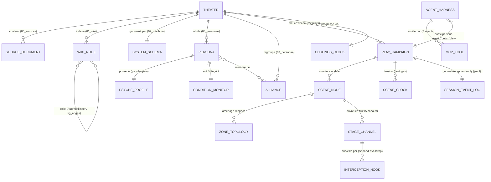
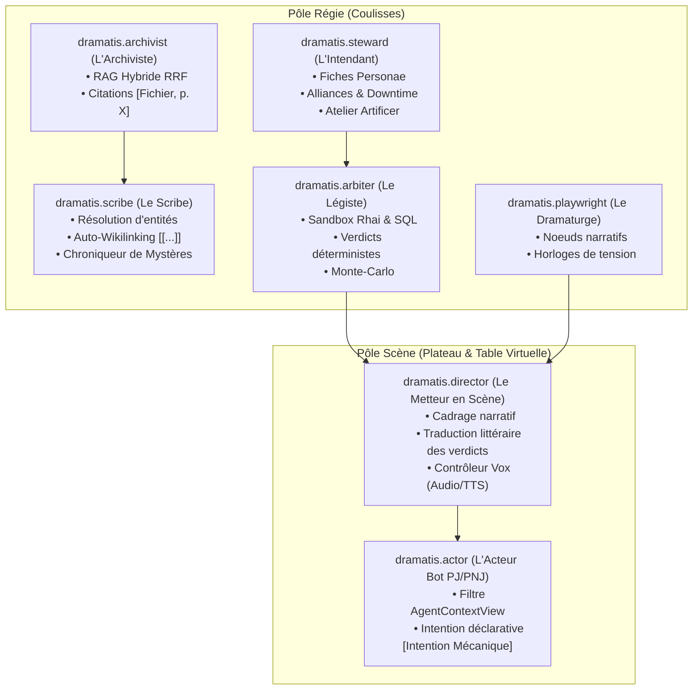
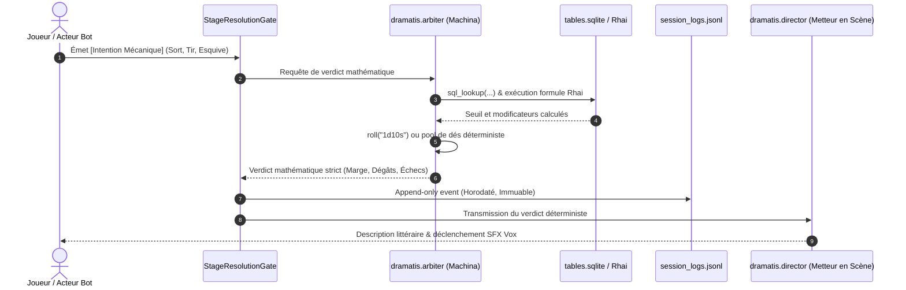

# Ontologie du Système Dramatis (v2.1)
*The Agentic Tabletop RPG Harness & World Engine*

> *« Narration vs Machina : La plume pour l'esprit, l'acier pour la loi. »*

Ce document formalise l'**ontologie complète de Dramatis** : la taxonomie des entités, leurs propriétés intrinsèques, leurs relations d'héritage, d'appartenance et d'interaction, ainsi que les axiomes fondamentaux qui régissent la simulation de jeux de rôle sur table.

---

## 1. Principes Fondateurs & Axiomes Ontologiques

1. **Axiome de Séparation Duale (`Narration vs Machina`)** :
   L'ontologie sépare strictement le domaine de la **Loi Mathématique** (*Machina*, déterministe, immuable, calculé en Rust/Rhai/SQLite) et le domaine de la **Formulation Sémantique** (*Narration*, interprétatif, génératif, exprimé par les LLM et les humains).
2. **Axiome d'Étanchéité Spatiale (`Theater Isolation`)** :
   L'univers racine est un `TheaterWorkspace`. Aucun état de jeu, chunk vectoriel, arête de graphe ou fiche ne traverse la frontière d'un Théâtre sans instanciation explicite.
3. **Axiome de Vérité Stratifiée (`Epistemic Stratification & Fog of War`)** :
   Toute entité et fait ontologique est assujetti à un niveau de canon (`CanonLevel`) et à un prisme de visibilité tridimensionnel : **Cognitif** (`Visibility` / `:::secret`), **Spatial** (`ZoneId` / Ligne de vue) et **Planaire** (`Physical`, `Astral`, `MatrixVr`, `MatrixAr`).

---

## 2. Graphe Conceptuel Global de l'Ontologie

---

## 3. Les 7 Pôles Ontologiques Majeurs

### 3.1 Pôle 1 : Espace Racine & Canon (`THEATER & KNOWLEDGE`)

#### `TheaterWorkspace`
* **Définition** : Racine d'isolation absolue d'un univers fictionnel (`*.dramatis`).
* **Propriétés** :
  * `id`: Identifiant unique (ex. `ars-magica-5e`, `shadowrun-6e`).
  * `name`: Libellé de l'univers.
  * `system_preset`: Schéma de règles associé (`ArsMagica5e`, `Shadowrun6e`, `Anastasius`, `Custom`).
  * `privacy_mode`: Mode de confidentialité (`strict_local` interdisant tout appel Cloud externe).
  * `default_language`: Code langue canonique (`fr`, `en`).
  * `git_repository`: Historique versionné des snapshots atomiques.

#### `SourceDocument`
* **Définition** : Artefact brut ingéré dans `/00_sources` (PDF, Markdown, DOCX, XLSX).
* **Propriétés** : `doc_id`, `sha256_hash`, `file_type`, `ingestion_timestamp`.

#### `WikiNode` (Entité du Graphe de Connaissances)
* **Définition** : Fiche encyclopédique structurée dans `/01_wiki`.
* **Propriétés** :
  * `id` & `title`: Identifiant canonique et titre affiché.
  * `category`: Taxonomie fermée (`lieux`, `factions`, `concepts`, `objets`, `pnj`, `bestiaire`, `histoire`).
  * `canon_level`: Niveau de vérité épistémique :
    * `Official`: Établi par les manuels officiels (Règles fondamentales).
    * `CampaignFact`: Fait avéré vécu lors des séances de jeu.
    * `Homebrew`: Règle maison ou extension de l'univers.
    * `CampaignRumor`: Information incertaine sujette à caution.
  * `visibility`: Règle de masquage (`Public`, `GmOnly`, `Targeted(Actors)`).
  * `locked_sections`: Segments balisés `<!-- LOCKED_BY_USER -->` protégés contre toute réécriture par les agents IA.

---

### 3.2 Pôle 2 : La Règle Déterministe (`MACHINA`)

#### `SystemSchema`
* **Définition** : Méta-déclaration agnostique des lois mathématiques du système (`02_machina/system_schema.json`).
* **Propriétés** :
  * `dice_mechanic`: Mécanique fondamentale (`d20`, `1d10_stress_and_simple`, `d6_pool_hits_5_6`, `2d12`, `d100`).
  * `characteristics` & `skills`: Liste typée des attributs et compétences.
  * `condition_monitors`: Types de jauges de santé et paliers de malus.
  * `planes`: Plans dimensionnels existants (`Physical`, `Astral`, `MatrixVr`, `MatrixAr`).

#### `RhaiFormula` & `TableMetadata`
* **Définition** : Algorithmes déterministes compilés dans `02_machina/formulas.rhai` et tables matricielles de `tables.sqlite`.
* **Capacités** :
  * Exécution sandboxée sans accès disque ni réseau non contrôlé.
  * Fonctions natives injectées : `roll(expression)`, `sql_lookup(table, target_col, key_col, key_val)`.

---

### 3.3 Pôle 3 : Le Temps & l'Usure (`CHRONOS`)

#### `ChronosClock`
* **Définition** : Moteur de temporalité fictionnelle gouvernant la campagne.
* **Propriétés** :
  * `current_timestamp_seconds`: Temps universel de jeu.
  * `calendar_system`: Calendrier (`Gregorian`, `HermeticSeasons`, `CyberpunkSeconds`).
  * `current_season`: Cycle saisonnier (`Spring`, `Summer`, `Autumn`, `Winter`).
* **Relations** :
  * Déclenche les `TimeHooks` lors de l'avancement saisonnier (avancement d'âge, coûts d'entretien de Covenant, cicatrisation, loyers).

---

### 3.4 Pôle 4 : Les Êtres & Collectifs (`PERSONA FORGE`)

#### `Persona` (Architecture à Triple Facette)
1. **Facette Légale (`persona.json`)** :
   * Attributs, compétences, arts, implants, sorts.
   * `condition_monitors` : Jauges de dégâts Physique / Étourdissant avec calcul déterministe des malus.
   * `essence` : Intégrité bio-métal exacte au centième près (ex. `6.00 - sum(cyberware)`).
2. **Facette Littéraire (`persona.md`)** :
   * Biographie, serments, descriptions sensorielles avec protection `LOCKED_BY_USER`.
3. **Facette Cognitive & Vocale (`psyche.json`)** :
   * Profil psychologique (`temperament`, `agenda`, `speech_register`).
   * `VoiceConfig` : Voix de synthèse TTS assignée pour le mixeur `Vox`.
   * `secrets_known` : Liste d'identifiants de secrets débloqués dans le brouillard de guerre.

#### `Alliance` (`Covenant` / Cellule / Syndicat)
* **Définition** : Entité collective abritant les personnages.
* **Propriétés** :
  * `aura_level` & `aura_type`: Intensité mystique ou sécuritaire du lieu.
  * `vis_stocks`: Stocks de ressources précieuses (Vis, Nuyens, Éther).
  * `laboratories`: Laboratoires de recherche artisanale (`Artificer`).
  * `library`: Grimoires (`Summae`, `Tractatus`) et fiches techniques.

#### `PartyLedger`
* **Définition** : Coffre d'équipe traçant les finances partagées, inventaires collectifs, dettes et niveau de notoriété (*Heat / Street Cred*).

---

### 3.5 Pôle 5 : La Scène & la Table Virtuelle (`STAGE MANAGER`)

#### `PlayCampaign` & `SceneNode`
* **Définition** : Instance d'aventure structurée en graphe nodal d'enjeux.
* **Composants** :
  * `world_state_delta` : Overlay d'état non-destructif modifiant l'univers sans corrompre le canon racine.
  * `SceneClock` : Horloge de tension segmentée (ex. 4, 6 ou 8 segments d'alerte).
  * `SessionEventLog` : Journal immuable append-only (`session_logs.jsonl`) permettant le **Rewind** temporel déterministe.

#### `ZoneTopology` & `TacticalTag`
* **Définition** : Découpage spatial de la scène tactique.
* **Propriétés** :
  * `ZoneId` : Identifiant de zone (ex. `zone-sanctuaire-haut`, `zone-parvis-bas`).
  * `TacticalTag` : Modificateurs environnementaux (`CoverLight`, `CoverHeavy`, `Darkness`, `HermeticAura(5)`).
  * `PlanarLayer` : Plan actif de l'acteur (`Physical`, `Astral`, `MatrixVr`, `MatrixAr`).

#### `StageChannel` (Les 5 Espaces Privés)
* `#zone-*` : Discussion ouverte aux acteurs présents dans la même zone physique.
* `#whisper-gm-*` : Aparté secret entre le MJ et un acteur précis.
* `#parley-*` : Négociation discrète entre deux ou plusieurs acteurs spécifiques.
* `#net-*` : Réseau cybernétique, commlink ou lien télépathique.
* `#ooc-lounge` : Échanges hors-rôle (Out Of Character).

#### `InterceptionHook`
* **Définition** : Règle déterministe de surveillance passive.
* **Types** :
  * `Eavesdrop` : Écoute physique clandestine dans une zone adjacente.
  * `MatrixSnoop` : Interception de paquets réseau chiffrés sur la grille matricielle.

---

### 3.6 Pôle 6 : Le Swarm des 7 Agents du Harnais (`AGENTS`)

---

### 3.7 Pôle 7 : La Passerelle d'Inférence (`SOUFFLEUR`)

#### `SouffleurGateway`
* **`AgentRoutingMatrix`** : Assignation granulaire d'un profil LLM par agent du harnais.
* **`ContextBudgeter`** : Comptage exact en tokens `tiktoken-rs` et élagage FIFO du contexte.
* **`McpToolSpec`** : Schémas JSON stricts validant et contraignant la sortie des agents.
* **`FallbackEngine`** : Bascule automatique vers le moteur déterministe local en cas d'indisponibilité du LLM.

---

## 4. Cycle de Vie d'une Action Ontologique (Exemple Typique)

---

## 5. Matrice Récapitulative des Formats de Persistance

| Entité Ontologique | Fichier Disque / Format | Règle de Modification |
| :--- | :--- | :--- |
| Configuration Théâtre | `theater.yaml` | Écriture humaine / Snapshots Git |
| Règles & Méta-Modèle | `02_machina/system_schema.json` | Déclaratif immuable en jeu |
| Formules du Système | `02_machina/formulas.rhai` | Transpilé d'Excel ou rédigé en Rhai |
| Matrices & Catalogues | `02_machina/tables.sqlite` | SQLite relationnel en lecture seule |
| Notes Encyclopédiques | `01_wiki/**/*.md` | Markdown + YAML + `<!-- LOCKED_BY_USER -->` |
| Index Vectoriel | LanceDB (`04_index/vectors/`) | Indexation automatique asynchrone |
| Index Lexical BM25 | Tantivy (`04_index/tantivy/`) | Indexation automatique asynchrone |
| Graphe de Relations | `knowledge_graph.sqlite` | Tables `entities`, `aliases`, `relationships` |
| Fiches Personnages | `*.persona.json` + `.md` + `.psyche.json` | Triple facette synchronisée |
| Événements de Jeu | `05_plays/{id}/session_logs.jsonl` | Append-only strict avec support Rewind |
